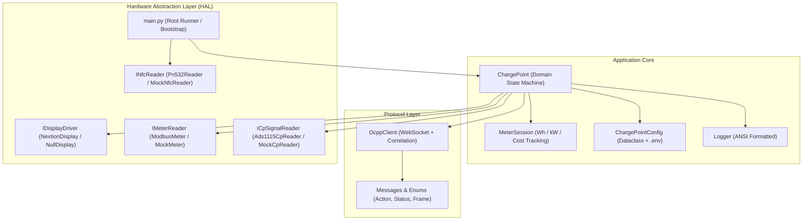

<p align="center">
  
  
  
  
  
  
  
</p>

<h1 align="center">⚡ ocpp-projectMTLSN</h1>

<p align="center">
  <strong>Production-Ready, Modular OCPP 1.6J EV Charge Point Simulator & Hardware Controller</strong><br>
  <em>Engineered with Clean Architecture, Asynchronous Protocol Correlation, Automatic Reconnection, and Hardware Abstraction (HAL).</em>
</p>

---

## 📖 Table of Contents

- [🎯 Overview](#-overview)
- [✨ Key Architectural Features](#-key-architectural-features)
- [🔌 Hardware & Peripherals Support](#-hardware--peripherals-support)
- [🏗️ Layered Architecture](#️-layered-architecture)
- [📦 Project Structure](#-project-structure)
- [🚀 Getting Started](#-getting-started)
  - [Prerequisites](#prerequisites)
  - [Installation](#installation)
  - [Configuration (.env)](#configuration-env)
  - [Running the Simulator](#running-the-simulator)
- [🧪 Running Unit Tests](#-running-unit-tests)
- [📡 Supported OCPP 1.6J Operations](#-supported-ocpp-16j-operations)
- [📄 License & Author](#-license--author)

---

## 🎯 Overview

**`ocpp-projectMTLSN`** is a high-performance, robust, and extensible Python-based EV Charger Controller and Simulator built on the **OCPP 1.6 JSON (OCPP-J)** specification over WebSockets.

It connects to any standard Central System Management System (**CSMS**) such as **SteVe**, **PowerFill**, **ChargePoint**, or custom proprietary cloud backends.

### 🌟 Why This Project?
- **Zero Global State**: Completely refactored from legacy scripts into an Object-Oriented, state-machine-driven architecture.
- **Hardware-Agnostic with HAL**: Seamlessly operates on **Raspberry Pi 3B+/4/5** with physical hardware (Nextion touchscreen, Modbus energy meter, ADS1115 ADC, PN532 NFC), or automatically switches to **Mock Drivers** on desktop PCs for pure simulation.
- **Fault-Tolerant WebSocket Client**: Handles disconnects with intelligent exponential backoff and correlates asynchronous request/response frames via `asyncio.Future`.

---

## ✨ Key Architectural Features

| Feature | Description |
|---|---|
| **Clean Architecture** | Strict separation of concerns across Protocol, Hardware, Domain Logic, Session, and Presentation layers. |
| **Request/Response Correlation** | Async tracking of OCPP Message IDs (`[2, mid, action, payload]`) with timeout-managed `Future` objects. |
| **Resilient Reconnection** | Automatic exponential backoff reconnection loop (`1s → 2s → 4s → 8s → 16s → 30s max`). |
| **Control Pilot (CP) State Machine** | Real-time ADC voltage monitoring mapped to IEC 61851-1 EV charging states (*Available, Connected, Charging, Ventilation, Fault*). |
| **Smart Meter Engine** | Thread-safe Modbus RTU energy reader with automated endianness/byte-order detection (`ABCD`, `DCBA`, `BADC`, `CDAB`) and drop-out protection. |
| **12-Factor App Config** | Type-safe `@dataclass` configuration with `.env` file and system environment variable overrides. No secrets in code. |
| **Full Test Suite** | 100% passing unit tests covering configuration, session math, protocol framing, and charge point lifecycle. |

---

## 🔌 Hardware & Peripherals Support

When deployed on embedded Linux / Raspberry Pi, the system interfaces with:

```
                  ┌──────────────────────────────┐
                  │    Raspberry Pi 3B+ / 4 / 5  │
                  └──────────────┬───────────────┘
                                 │
     ┌───────────────────────────┼──────────────────────────┐
     ▼ (UART /dev/ttyAMA0)       ▼ (RS-485 USB / Modbus)    ▼ (I2C Bus 1)
┌──────────────┐          ┌──────────────┐          ┌──────────────┐
│ Nextion 3.5" │          │ Modbus Meter │          │ ADS1115 ADC  │ (0x48)
│  HMI Touch   │          │ Active Wh    │          │  (CP Sensing)│
└──────────────┘          └──────────────┘          └──────────────┘
                                                           │
                                                    ┌──────────────┐
                                                    │  PN532 NFC   │ (0x24)
                                                    │  (RFID Auth) │
                                                    └──────────────┘
```

1. **Nextion 3.5" UART Touchscreen** (`/dev/ttyAMA0`, 9600 Baud): Real-time UI displaying charging status, elapsed time, power (kW), total energy (kWh), calculated cost, and RFID scan screens.
2. **Modbus Energy Meter** (RS-485 via USB `/dev/ttyUSB0`): High-precision reading of active import energy register (`Wh`).
3. **ADS1115 16-bit ADC** (I2C): Reads EV Control Pilot voltage with hardware divider (Gain=1, Multiplier=4.0303).
4. **PN532 NFC / RFID Reader** (I2C): Intercepts Mifare / NFC tags to authenticate authorized users before allowing charge start.

> 💡 **Desktop / CI Fallback:** If serial or I2C devices are not detected, `ocpp-projectMTLSN` logs a warning and automatically falls back to `NullDisplay`, `MockMeter`, `MockCpReader`, and `MockNfcReader` without crashing.

---

## 🏗️ Layered Architecture



---

## 📦 Project Structure

```text
ocpp-projectMTLSN/
│
├── main.py                          # Root application runner (python main.py)
├── pyproject.toml                   # Modern Python build & tool configuration
├── pytest.ini                       # Pytest test runner settings
├── requirements.txt                 # Runtime & development dependencies
├── .env.example                     # Environment template for CSMS credentials
├── README.md                        # Documentation
├── LICENSE                          # MIT License
│
├── src/
│   └── ocpp_charger/
│       ├── __init__.py              # Package initialization
│       ├── main.py                  # Dependency injection & bootstrap routine
│       ├── config.py                # Type-safe configuration dataclass
│       ├── logger.py                # ANSI color-coded operational logger
│       ├── charge_point.py          # Central ChargePoint State Machine
│       ├── session.py               # Energy measurement & power calculator
│       │
│       ├── protocol/
│       │   ├── __init__.py
│       │   ├── client.py            # Async WebSocket client with req/res correlation
│       │   └── messages.py          # OCPP 1.6 action enums & response schemas
│       │
│       └── hardware/
│           ├── __init__.py
│           ├── display.py           # Touchscreen driver (Nextion & Null fallback)
│           ├── meter.py             # Modbus RTU meter & candidate float decoder
│           ├── cp_signal.py         # ADS1115 ADC reader & EV status mapper
│           └── nfc.py               # PN532 I2C RFID reader & lazy initializer
│
├── tests/
│   ├── __init__.py
│   ├── test_config.py               # Configuration & validation tests
│   ├── test_session.py              # Energy session calculus & drop-out protection
│   ├── test_protocol.py             # OCPP message types & response mapping
│   └── test_charge_point.py         # State machine & server command tests
│
└── docs/
    └── ocpp-flow.md                 # OCPP message interaction sequences
```

---

## 🚀 Getting Started

### Prerequisites
- Python **3.9+** (Tested on Python 3.9, 3.10, 3.11, 3.12, 3.14)
- A running CSMS backend (or testing service)

### Installation

```bash
# 1. Clone the repository
git clone https://github.com/your-username/ocpp-projectMTLSN.git
cd ocpp-projectMTLSN

# 2. (Optional) Create and activate virtual environment
python -m venv venv
source venv/bin/activate       # Linux / macOS
# or
.\venv\Scripts\Activate.ps1   # Windows PowerShell

# 3. Install dependencies
pip install -r requirements.txt
```

### Configuration (.env)

Create your `.env` configuration file from the template:

```bash
cp .env.example .env     # Linux / macOS
# or
copy .env.example .env   # Windows
```

Edit `.env` to configure your CSMS server and credentials:

```env
# ─── CSMS Connection ─────────────────────────────────────────────────────────
CSMS_URL=wss://your-csms-domain.com/ws/CP-1
CHARGE_BOX_ID=CP-1

# ─── Authentication ──────────────────────────────────────────────────────────
USER_ID_TAG=hasanyildizidtag
BASIC_AUTH_USER=CP-1
BASIC_AUTH_PASSWORD=your_secure_password

# ─── NFC Card UID ────────────────────────────────────────────────────────────
NFC_ALLOWED_ID=97350E07
```

### Running the Simulator

Launch the controller with a single command:

```bash
python main.py
```

The interactive terminal banner will launch, connect to the CSMS via WebSocket, transmit `BootNotification`, and initiate periodic `Heartbeat` and CP signal monitoring:

```text
12:30:00.123  INFO  Bağlandı ✓ (wss://your-csms-domain.com/ws/CP-1)
12:30:00.150  SEND  [BootNotification] {'chargePointVendor': 'TestVendor', ...}
12:30:00.220  RECV  [Response/1] {'status': 'Accepted', 'interval': 30}
12:30:00.230  SEND  [StatusNotification] {'connectorId': 1, 'status': 'Available', ...}
```

---

## 🧪 Running Unit Tests

The test suite is powered by `pytest` and `pytest-asyncio`:

```bash
python -m pytest
```

Output:
```text
============================= test session starts =============================
collected 20 items

tests/test_charge_point.py .......                                       [ 35%]
tests/test_config.py ....                                                [ 55%]
tests/test_protocol.py ....                                              [ 75%]
tests/test_session.py .....                                              [100%]

============================= 20 passed in 0.03s ==============================
```

---

## 📡 Supported OCPP 1.6J Operations

### Charge Point ➔ CSMS (Client-Initiated)
- `BootNotification`
- `Heartbeat`
- `StatusNotification` (*Available, Preparing, Charging, SuspendedEV, Faulted, Unavailable*)
- `Authorize`
- `StartTransaction`
- `MeterValues` (*sampled active energy Wh, voltage V, current A, active power W*)
- `StopTransaction`

### CSMS ➔ Charge Point (Server-Initiated Commands)
- `GetConfiguration`
- `ChangeConfiguration`
- `Reset` (*Soft / Hard reset*)
- `RemoteStartTransaction`
- `RemoteStopTransaction`
- `TriggerMessage`
- `UnlockConnector`
- `ClearCache`

---

## 📄 License & Author

Distributed under the **MIT License**. See [`LICENSE`](LICENSE) for more details.

Developed for reliable EV charging station simulation, hardware integration, and end-to-end CSMS validation.
