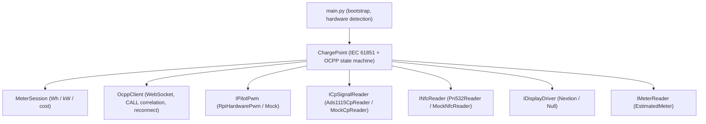

<p align="center">
  
  
  
  
  
  
  
</p>

<h1 align="center">⚡ ocpp-evse-charger-sim</h1>

<p align="center">
  <strong>OCPP 1.6J EV Charge Point Controller & Simulator for Raspberry Pi</strong><br>
  <em>IEC 61851-1 control pilot (PWM + ADS1115), NFC card per session, Nextion HMI — with a full desktop simulation mode.</em>
</p>

---

## 🎯 Overview

A Python OCPP 1.6-J charge point that runs on a **Raspberry Pi Zero 2 W** with a
custom pilot board (see `docs/donanim-test-plani.md`), and falls back to a
simulated EV / meter / NFC reader on a desktop PC.

- **Card per session** — every charge starts and ends with an NFC tap; the card UID (or a mapped idTag) is authorized by the CSMS.
- **Real control pilot** — GPIO12 hardware PWM drives an LM358 comparator to ±12 V; ADS1115 reads the pilot (A0) and cable PP (A1).
- **OCPP-correct** — idTagInfo checks, one outstanding CALL at a time, CALLERROR for unsupported actions, Remote Start/Stop validation, ChangeAvailability, real configuration keys, TriggerMessage, Reset.
- **Resilient** — reconnects with backoff after any drop, heartbeat watchdog, StopTransaction queued while offline.

## 🔌 Hardware

```
                  ┌──────────────────────────────┐
                  │   Raspberry Pi Zero 2 W      │
                  └──────────────┬───────────────┘
     ┌──────────────┬────────────┴─────┬──────────────────┐
     ▼ UART         ▼ I2C              ▼ I2C              ▼ GPIO12 (PWM0)
┌──────────┐  ┌──────────────┐  ┌──────────┐  ┌──────────────────────┐
│ Nextion  │  │ ADS1115 0x48 │  │ PN532    │  │ LM358 comparator     │
│ HMI      │  │ A0=CP  A1=PP │  │ NFC 0x24 │  │ ±12 V (TC1044S) → CP │
└──────────┘  └──────────────┘  └──────────┘  └──────────────────────┘
```

The board has no energy meter: energy is **estimated** as offered current ×
`NOMINAL_VOLTAGE` × `PHASES` while the EV is in state C. The EV may draw less
than offered, so treat it as an upper bound, not a billing value.

`HARDWARE_MODE=auto` (default) uses whatever is found and simulates the rest
with a warning; `pi` refuses to start without all devices; `sim` simulates
everything.

## 🏗️ Architecture



## 📦 Project Structure

```text
├── main.py                      # python main.py [run|pilot-test]
├── requirements.txt / requirements-pi.txt
├── .env.example                 # copy to .env (never committed)
├── src/ocpp_charger/
│   ├── main.py                  # hardware detection & wiring
│   ├── config.py                # dataclass config, every field ← ENV
│   ├── charge_point.py          # session / pilot / OCPP state machine
│   ├── session.py               # energy & power calculation
│   ├── protocol/client.py       # OCPP-J client
│   ├── protocol/messages.py     # enums, CallResult, OcppCallError
│   ├── hardware/pilot.py        # GPIO12 PWM, duty ↔ current
│   ├── hardware/cp_signal.py    # ADS1115, CP divider math, PP decoding
│   ├── hardware/nfc.py          # PN532 over I2C
│   ├── hardware/display.py      # Nextion
│   ├── hardware/meter.py        # energy estimate from the offered current
│   └── tools/pilot_test.py      # bench test for the pilot board
├── tests/
└── docs/
    ├── ocpp-flow.md             # message flows & status mapping
    └── donanim-test-plani.md    # schematic analysis & perfboard test plan (TR)
```

## 🚀 Getting Started

```bash
pip install -r requirements.txt          # desktop
pip install -r requirements-pi.txt       # Raspberry Pi
cp .env.example .env                     # then edit CSMS_URL, BASIC_AUTH_*, NFC_ID_TAG_MAP
python main.py
```

On the Pi, enable I2C and the PWM overlay first (see `docs/donanim-test-plani.md`).

### Console commands

| Command | |
|---|---|
| `card <UID>` | simulate an NFC tap (works on hardware too) |
| `plug` / `unplug` | (sim) connect / disconnect the virtual EV — it goes to state C as soon as PWM starts |
| `ev A..E`, `pp 13/20/32/63/none` | (sim) force pilot state / cable rating |
| `stop`, `status`, `q` | stop session, show state, quit |

### Bench-testing the pilot board

```bash
python main.py pilot-test     # high / low / pwm 16 / watch / table
```

## 🧪 Tests

```bash
python -m pytest
```

## 📡 Supported OCPP 1.6J Operations

**Charge Point → CSMS:** BootNotification, Heartbeat, StatusNotification, Authorize, StartTransaction, MeterValues, StopTransaction

**CSMS → Charge Point:** RemoteStartTransaction, RemoteStopTransaction, Reset, ChangeAvailability, GetConfiguration, ChangeConfiguration, TriggerMessage, UnlockConnector (NotSupported), ClearCache, DataTransfer (UnknownVendorId); everything else → CALLERROR NotImplemented.

See [`docs/ocpp-flow.md`](docs/ocpp-flow.md).

## 📄 License

MIT — see [`LICENSE`](LICENSE).
